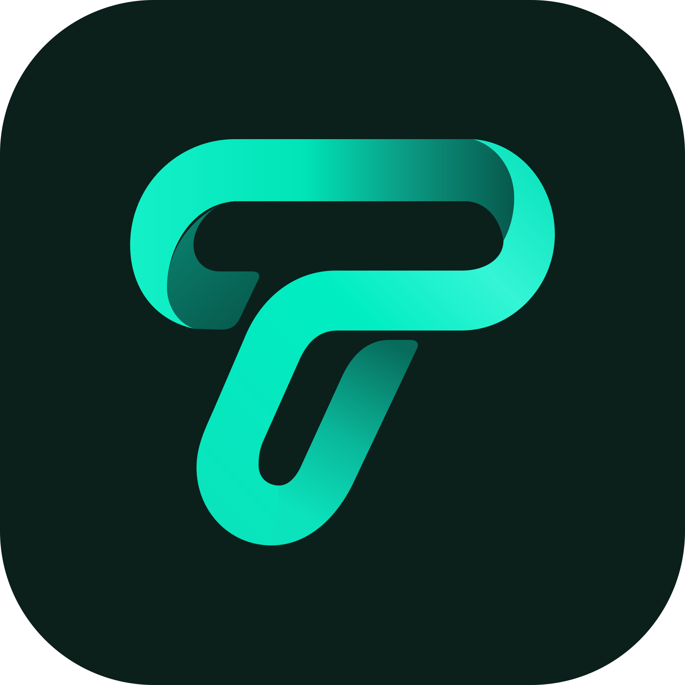
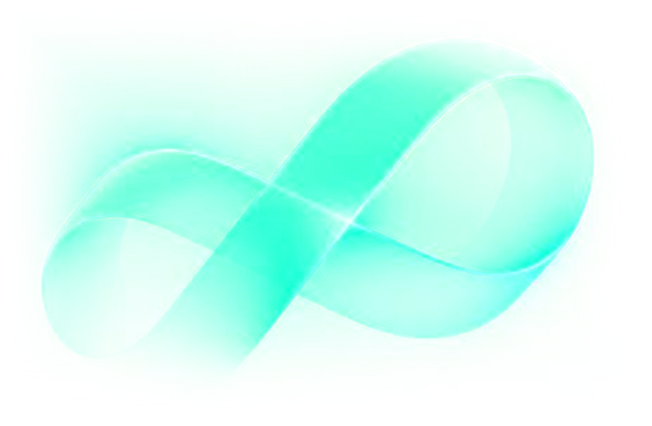

For anyone who writes about kUSDT, lists it or integrates with Trestly. Every file here is one the project uses
itself, unchanged. For questions, ask in [t.me/trestly](https://t.me/trestly).

## Names

| Write | For |
|---|---|
| **Trestly** | The product: the bridge, its web app and these docs |
| **kUSDT** | The token on Kaspa: a lower-case k, then USDT in capitals |
| **kUSDT Wallet** | The browser extension |
| **KasPool** | The KAS⇄kUSDT pool on Kaspa L1 |

kUSDT is not USDT and is not issued by Tether ([FAQ](/reference/faq/#is-kusdt-issued-by-tether)). Don't write
"USDT" when you mean kUSDT, and don't shorten kUSDT to anything else.

## Logo files

### The mark

Trestly's ribbon T, on a transparent background. The web app shows it in its header, beside the word Trestly, on its
dark and its light pages alike.

| Format | Size | Download |
|---|---|---|
| SVG | Scalable | <a href="/media/trestly-mark.svg" download>trestly-mark.svg</a> |

### The app icon

The mark on a dark rounded square. It is the web app's and these docs' browser icon. The PNG is the web app's icon
for phone home screens, with square corners.

| Format | Size | Download |
|---|---|---|
| SVG | Scalable | <a href="/media/trestly-icon.svg" download>trestly-icon.svg</a> |
| PNG | 180 × 180 | <a href="/media/trestly-icon-180.png" download>trestly-icon-180.png</a> |

### kUSDT Wallet's icon

The browser extension's icon, at the sizes the extension ships.

| Format | Size | Download |
|---|---|---|
| PNG | 128 × 128 | <a href="/media/kusdt-wallet-icon-128.png" download>kusdt-wallet-icon-128.png</a> |
| PNG | 48 × 48 | <a href="/media/kusdt-wallet-icon-48.png" download>kusdt-wallet-icon-48.png</a> |
| PNG | 32 × 32 | <a href="/media/kusdt-wallet-icon-32.png" download>kusdt-wallet-icon-32.png</a> |
| PNG | 16 × 16 | <a href="/media/kusdt-wallet-icon-16.png" download>kusdt-wallet-icon-16.png</a> |

### The ribbon

The brand's artwork, on a transparent background: the picture on these docs' home page and in the social preview
cards, and on the web app's main page where the browser cannot draw it live.

| Format | Size | Download |
|---|---|---|
| WebP | 936 × 612 | <a href="/media/trestly-ribbon.webp" download>trestly-ribbon.webp</a> |

### Not in the kit

- **No wordmark file.** The web app writes the word "Trestly" as text beside the mark, in Figtree at weight 600
  (see [Typefaces](#typefaces)). There is no file of the word, or of the mark and the word together.
- **No one-colour version.** There is no white, black or single-colour version of the mark.
- **No kUSDT logo of its own.** The web app and kUSDT Wallet show kUSDT as Tether's mark with a small Kaspa badge.
  Those marks belong to their owners, so that picture is not in this kit.

## Colours

The web app's palette (`bridge/web/src/styles.css`). Dark is its default.

| Role | Dark | Light |
|---|---|---|
| Page |  `#051316` |  `#f2f7fd` |
| Cards |  `#0e1a1c` |  `#ffffff` |
| Fields and tiles |  `#152a2d` |  `#eef3f7` |
| Lines |  `#1b2c2f` |  `#e2e9ef` |
| Text |  `#f4f8f7` |  `#0b1f1b` |
| Muted text |  `#9aa9a9` |  `#55686c` |
| Mint: filled buttons |  `#45f8d1` |  `#2ff0c8` |
| Text on mint |  `#06211c` |  `#06211c` |
| Accent: mint as text or a thin line |  `#45f8d1` |  `#077a66` |
| Warnings (amber) |  `#f59e0b` |  `#b45309` |
| Errors (rose) |  `#f87171` |  `#b91c1c` |
| The EVM side |  `#9aa3b5` |  `#4f5b73` |

Mint is kept for the one thing to press; amber is for warnings and rose for errors.

The mark has colours of its own, in its gradients. They are in the SVG file:

| Part of the mark | Gradient stops |
|---|---|
| Top band | `#14F0C8`, `#00E5B8`, `#0B9A84`, `#07594C` |
| Front band | `#0BE3BC`, `#00EDC2`, `#34F5D6`, `#12E6C1` |
| Fold | `#0A7E6B`, `#075A4D` |
| Back band | `#086B5B`, `#0AB79A`, `#0BE3BC` |
| The app icon's square | `#0B1F1B` |

## Typefaces

| Use | Typeface |
|---|---|
| All text, and the word Trestly beside the mark | [Figtree](https://github.com/erikdkennedy/figtree), the variable font. The word Trestly is set at weight 600, letter spacing −0.012 em. Figtree is under the SIL Open Font License 1.1 |
| Addresses, IDs and code | The system's monospace font (`ui-monospace, SFMono-Regular, Menlo, Consolas, 'Liberation Mono', monospace`) |

Where Figtree is missing, the web app falls back to the system's sans-serif font.

## Do's and don'ts

Do:

- use the files as they are, at their own proportions;
- write the names as in [Names](#names);
- link to the web app or to these docs for anything about how kUSDT works.

Don't:

- change the logos: no new colours, no redrawing, stretching, rotating, cropping or effects, no words added to them;
- imply a partnership, an endorsement or a review by Trestly that does not exist;
- use the name or the marks for another token, a fork, or a copy of the bridge, the web app or the wallet;
- call kUSDT USDT, or say that Tether issues it.

## Other projects' marks

The Ethereum, BNB Chain, Kaspa and USDT logos belong to their owners and are not part of this kit. The web app shows
them to name the networks and the tokens. Take them from their owners, on their terms.

## Using the name

- You may say that you support kUSDT, or that your product integrates with Trestly.
- You may not present yourself as Trestly or as its operators, or speak for them.
- Point your users to the project's own channels: the web app ([trestly.io](https://trestly.io)), these docs, [t.me/trestly](https://t.me/trestly) and [x.com/trestly_io](https://x.com/trestly_io).

For an integration, see [Integrate with Trestly](/integrate/overview/) and
[Risks to tell your users](/integrate/risks/).
